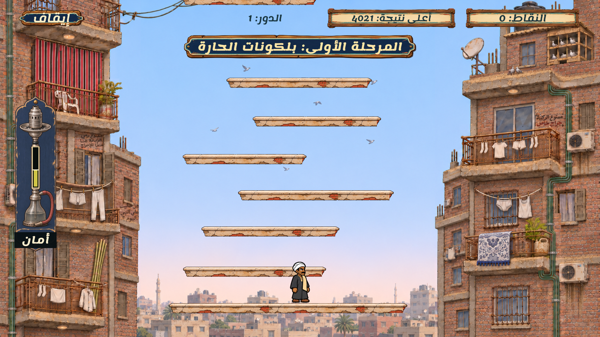
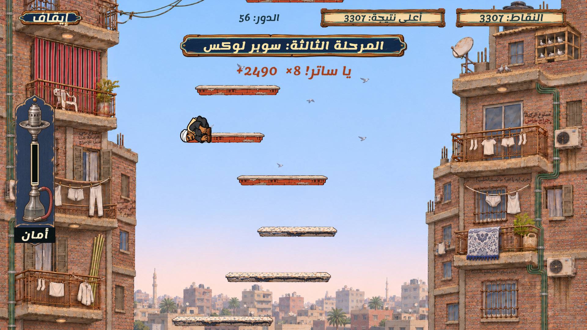

  

  الحكاية بدأت لما واحد صعيدي لطش حتة آثار من اللي في ناس ناوية تبيع تاريخ البلد. ولما اتقفش وبقوا وراه في كل حتة، طلع عالعمارات، وكل دور بمصيبة جديدة... بس النزول ملوش سكة! 
  An Egyptian 2D arcade platformer where you climb the buildings of Asyut, chain combos, and chase high scores.

  <strong>Engine:</strong> Unity 6000.3.2f1 · <strong>Language:</strong> C# · <strong>Platform:</strong> Windows (x64)

  
  &nbsp;
  
  &nbsp;
  

https://github.com/user-attachments/assets/f6ad54ed-5cd2-418e-8377-16f50c50745b

## طريقة اللعب · Gameplay

- اجمع سرعة عشان تقفز أعلى، وارتد من الحيطان واعمل شقلبات.
- تخطّى أكتر من دور في قفزة واحدة عشان تزود الـ Combo والنقاط.
- اطلع عبر أربع مراحل متصلة، وراقب مؤشر الخطر على شكل الشيشة مع صعود الكاميرا.
- لو وقعت تحت الشاشة، المحاولة بتنتهي وأعلى نتيجة بتتحفظ تلقائيًا.

اللعبة فيها قوائم عربية، وأصوات صعيدية، وتحكم في الصوت وإيقاف مؤقت وتعليمات للعب.

*Build momentum, skip floors and beat your high score across four stages before the rising camera catches up.*

## المراحل · Stages

| الأدوار · Floors | المرحلة · Stage | المنصات · Platforms |
|:---:|---|---|
| 1–25 | بلكونة بنت الجيران · The Neighbor Girl's Balcony | محارة بلكونات قديمة وطوب ظاهر · Chipped balcony plaster and exposed brick |
| 26–55 | لحن الموزايكو · Mosaic Melody | موزايكو وأسمنت أسطح قديم · Worn terrazzo and rooftop cement |
| 56–90 | سوبر لوكس · Super Lux | طوب أحمر وسطح خرساني · Red clay brickwork and concrete |
| 91+ | توت عنخ هموت · Tut Ankh Hamoot | توابيت فرعونية بالذهبي والأزرق · Gold and blue pharaonic coffins |

<table>
  <tr>
    <td width="50%" align="center"> <strong>بلكونة بنت الجيران · The Neighbor Girl's Balcony</strong></td>
    <td width="50%" align="center"> <strong>لحن الموزايكو · Mosaic Melody</strong></td>
  </tr>
  <tr>
    <td width="50%" align="center"> <strong>سوبر لوكس · Super Lux</strong></td>
    <td width="50%" align="center"> <strong>توت عنخ هموت · Tut Ankh Hamoot</strong></td>
  </tr>
</table>

## التحكم · Controls

| الزر · Key | الوظيفة · Action |
|---|---|
| A / D أو / or ← / → | الحركة وتجميع السرعة · Move and build momentum |
| Space | القفز؛ اترك الزر مبكرًا لقفزة أقصر · Jump; release early for a shorter jump |
| Escape | إيقاف مؤقت / استكمال · Pause / resume |
| R بعد الخسارة / after Game Over | إعادة اللعب · Restart |
| Alt + Enter | تبديل وضع العرض · Toggle display mode |

## صور من اللعبة · Screenshots

اضغط على أي صورة لعرضها كاملة. / Click any screenshot to open the full-size image.

| نقاط وCombo · Score and combo | القائمة الرئيسية · Main menu |
|:---:|:---:|
|  |  |

  
  &nbsp;
  

## تشغيل نسخة ويندوز · Play on Windows

حمّل ملف اللعبة وفك ضغطه بالكامل، ثم شغّل `icy tower Asyut.exe`. اترك مجلد البيانات وملف `UnityPlayer.dll` ومجلدات التشغيل بجوار الملف التنفيذي. الموسيقى المختارة والأصوات مدمجة داخل النسخة.

Download and extract the complete Windows ZIP, then run `icy tower Asyut.exe`. Keep its Data directory, `UnityPlayer.dll` and runtime folders beside the executable. The selected soundtrack and voice recordings are included.

## فتح المشروع · Open the project

1. نزّل المستودع باستخدام Git مع تثبيت Git LFS، ثم نفّذ `git lfs pull`. / Clone with Git LFS installed, then run `git lfs pull`.
2. أضف مجلد المشروع في Unity Hub. / Add the project folder in Unity Hub.
3. انتظر تحميل الحزم وتجهيز ملفات المشروع. / Allow packages to restore and the Library folder to regenerate.
4. افتح `Assets/Ma3alem/Scenes/MainMenu.unity` واضغط Play. / Open `Assets/Ma3alem/Scenes/MainMenu.unity` and press Play.

## تنظيم الملفات · Source organization

السكربتات الأساسية داخل `Assets/Ma3alem/Scripts`: ‏PlayerController وPlatformSpawner وCameraFollow وScoreManager وGameManager وAudioManager وUIManager، ومعها BuildingBackdrop لعرض العمارات. المشاهد والرسومات والخطوط والصوت والـPrefabs موجودة داخل `Assets`، وإعدادات المشروع والحزم داخل `ProjectSettings` و`Packages`. الاختبارات داخل `Assets/Ma3alem/Tests`.

`Assets/Ma3alem/Scripts` contains PlayerController, PlatformSpawner, CameraFollow, ScoreManager, GameManager, AudioManager and UIManager, plus the BuildingBackdrop presentation helper. Scenes, prefabs, artwork, fonts and audio remain under `Assets`; project configuration and packages are in `ProjectSettings` and `Packages`. Tests are in `Assets/Ma3alem/Tests`.

## الأصول والتراخيص · Assets and attribution

- التسجيلات الصعيدية محفوظة بأدائها وسرعتها وطبقتها الأصلية، والمؤثرات داخل `Assets/Ma3alem/Audio`. / Supplied Saidi recordings preserve their original performance, speed and pitch; effects are in `Assets/Ma3alem/Audio`.
- خطوط Lemonada وNoto مرفق بها ترخيص SIL Open Font License. / Lemonada and Noto retain their SIL Open Font License notices.
- مكتبة RTLTMPro تحت ترخيص MIT داخل `Assets/ThirdParty`، مع الاحتفاظ بإشعارات الخطوط المرفقة. / RTLTMPro retains its MIT license under `Assets/ThirdParty`, alongside the bundled font notices.
- الموسيقى المختارة مدمجة بإذن النشر الذي أكده صاحب المشروع. / The selected soundtrack is included with distribution permission confirmed by the project owner.
