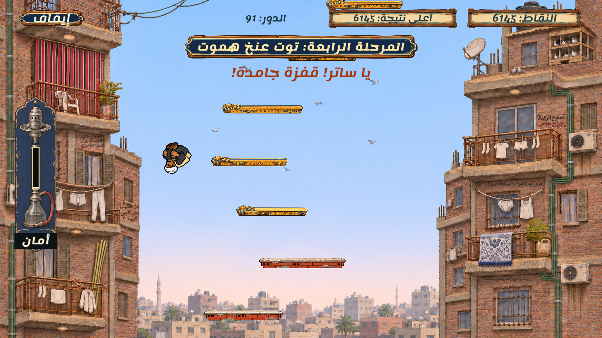
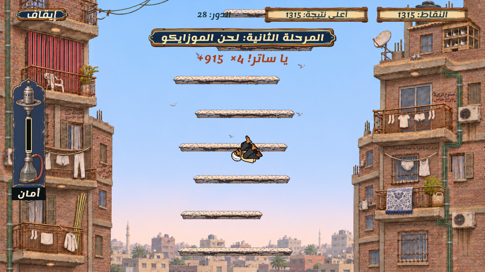
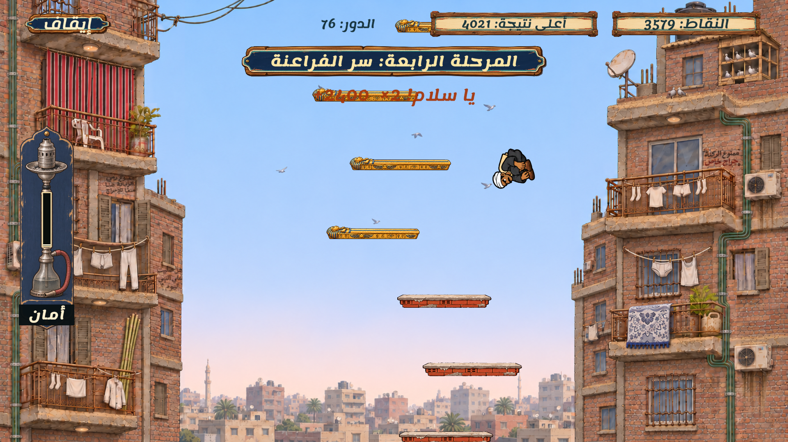

https://github.com/user-attachments/assets/18a614be-7410-43f1-9e62-dbc0ee036a21

# برج أسيوط · icy tower Asyut

**من حواري أسيوط... لفوق!**

An Egyptian arcade tower climber. Build speed, leap across floors, bounce off walls and chain somersaults through four stages inspired by the streets of Assiut.

**[▶ Watch the trailer](https://github.com/user-attachments/assets/18a614be-7410-43f1-9e62-dbc0ee036a21)** · **[Download for Windows](https://github.com/mohamadhussien6/borg-asyut/releases/latest/download/Borg_Asyut_Windows.zip)** · **[Game documentation](https://github.com/mohamadhussien6/borg-asyut/releases/latest/download/Borg_Asyut_Documentation.pdf)**

> **اللي أبوه صعيدي ميخافِش!**

## اجري... انط... شقلب!

Keep your momentum to jump higher, skip floors to grow your combo, and watch the shisha danger meter as the camera climbs. Fall behind, restart, and try to beat your saved best score.

- Momentum-based running and jumps, wall rebounds and somersaults.
- Four continuous stages with distinct platform artwork.
- Egyptian buildings, a Saidi hero and supplied Saidi voice reactions.
- Arabic menus, pause, help and separate sound controls.

## From the balconies to the pharaohs

| Floors | Stage | Platforms |
|:---:|---|---|
| 1–20 | بلكونات الحارة | Chipped balcony plaster and exposed brick |
| 21–45 | فوق السطوح | Worn terrazzo and rooftop cement |
| 46–75 | تحت التشطيب | Red clay brickwork and concrete |
| 76+ | سر الفراعنة | Gold and blue pharaonic coffins |

## Controls

| Key | Action |
|---|---|
| A / D or ← / → | Run and build momentum |
| Space | Jump; release early for a shorter jump |
| Escape | Pause / resume |
| R after Game Over | Restart |
| Alt + Enter | Toggle display mode |

## Gameplay gallery

| Momentum and combos | The pharaohs' secret |
|---|---|
|  |  |

[View all 15 gameplay screenshots →](Media/Screenshots)

## Run the project

1. Clone this repository with Git LFS installed, then run `git lfs pull`.
2. Add the project folder in Unity Hub and use the editor version recorded in `ProjectSettings/ProjectVersion.txt`.
3. Allow Unity to restore packages and regenerate its Library folder.
4. Open `Assets/Ma3alem/Scenes/MainMenu.unity` and press Play.

For the standalone version, extract the complete Windows ZIP and run `icy tower Asyut.exe`. Keep its Data directory, UnityPlayer.dll and runtime folders together.

## Source organization

`Assets/Ma3alem/Scripts` contains seven main gameplay scripts: PlayerController, PlatformSpawner, CameraFollow, ScoreManager, GameManager, AudioManager and UIManager. BuildingBackdrop is the presentation helper. Scenes, prefabs, artwork, fonts, audio and metadata remain under Assets. Packages and ProjectSettings are included. Tests remain in Assets/Ma3alem/Tests.

## Assets and attribution

- Supplied Saidi voice recordings retain their original performance, pitch and speed. Project sound effects remain in Assets/Ma3alem/Audio.
- Lemonada and Noto fonts retain their SIL Open Font License notices under Assets/Ma3alem/Fonts and third-party resource folders.
- RTLTMPro retains its MIT license under Assets/ThirdParty. Other bundled TMP font notices remain alongside their resources.
- The selected local MP3 is excluded from repository source and the distributable Windows build. The private promotional trailer uses the owner-selected soundtrack; no replacement track was created. No public music-redistribution license is asserted.

