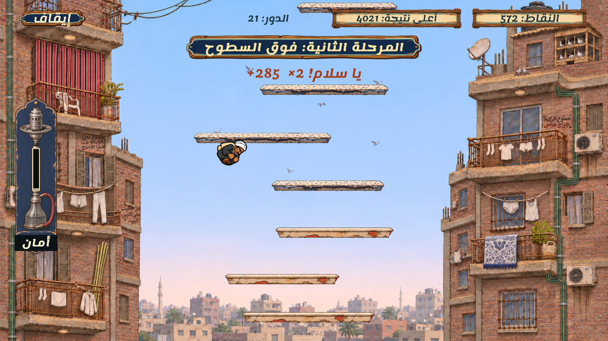
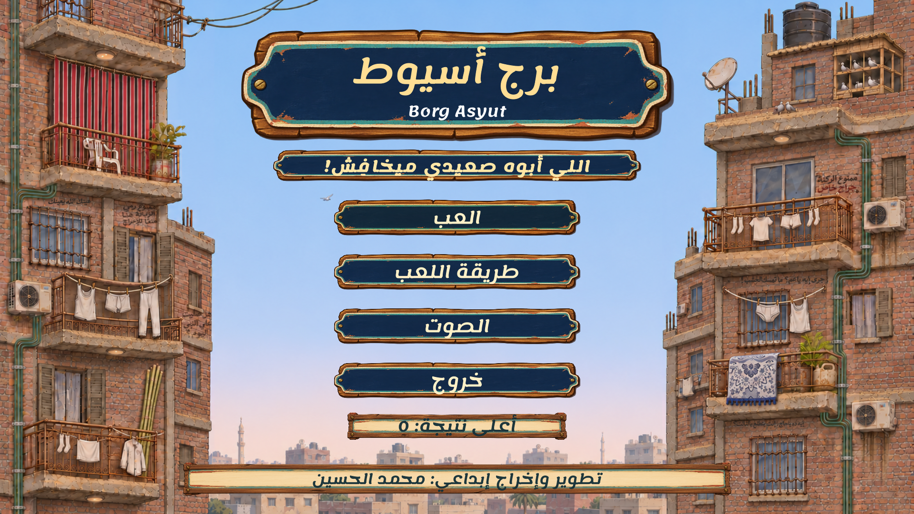

<p align="center">
  
</p>

<h1 align="center">برج أسيوط · icy tower Asyut</h1>

<p align="center"><strong>اللي أبوه صعيدي ميخافِش</strong></p>

<p align="center">
  لعبة أركيد مصرية ثنائية الأبعاد بتاخدك بين عمارات أسيوط. اطلع لأعلى دور تقدر توصله بشخصية صعيدية وسط أجواء مصرية.<br>
  An Egyptian 2D arcade tower climber set in the streets of Assiut.
</p>

<p align="center">
  <strong>Engine:</strong> Unity 6000.3.2f1 · <strong>Language:</strong> C# · <strong>Platform:</strong> Windows (x64)
</p>

<p align="center">
  <a href="https://github.com/user-attachments/assets/f6ad54ed-5cd2-418e-8377-16f50c50745b"></a>
  &nbsp;
  <a href="https://github.com/mohamadhussien6/borg-Asyut/releases/latest/download/Borg_Asyut_Windows.zip"></a>
  &nbsp;
  <a href="https://github.com/mohamadhussien6/borg-Asyut/blob/main/Documentation/Final/Asyut_Game_Documentation_Final.pdf"></a>
</p>

https://github.com/user-attachments/assets/f6ad54ed-5cd2-418e-8377-16f50c50745b

## طريقة اللعب · Gameplay

- اجمع سرعة عشان تقفز أعلى، وارتد من الحيطان واعمل شقلبات.
- تخطّى أكتر من دور في قفزة واحدة عشان تزود الـ Combo والنقاط.
- اطلع عبر أربع مراحل متصلة، وراقب مؤشر الخطر على شكل الشيشة مع صعود الكاميرا.
- لو وقعت تحت الشاشة، المحاولة بتنتهي وأعلى نتيجة بتتحفظ تلقائيًا.

اللعبة فيها قوائم عربية، وأصوات صعيدية، وتحكم في الصوت وإيقاف مؤقت وتعليمات للعب.

*Build momentum, skip floors and beat your high score across four stages before the rising camera catches up.*

## المراحل · Stages

| الأدوار · Floors | المرحلة · Stage | المنصات · Platforms |
|:---:|---|---|
| 1–25 | بلكونة بنت الجيران · The Neighbor Girl's Balcony | محارة بلكونات قديمة وطوب ظاهر · Chipped balcony plaster and exposed brick |
| 26–55 | لحن الموزايكو · Mosaic Melody | موزايكو وأسمنت أسطح قديم · Worn terrazzo and rooftop cement |
| 56–90 | سوبر لوكس · Super Lux | طوب أحمر وسطح خرساني · Red clay brickwork and concrete |
| 91+ | توت عنخ هموت · Tut Ankh Hamoot | توابيت فرعونية بالذهبي والأزرق · Gold and blue pharaonic coffins |

<table>
  <tr>
    <td width="50%" align="center"><a href="Media/Screenshots/03_Stage_1.png"></a><br><strong>بلكونة بنت الجيران · The Neighbor Girl's Balcony</strong></td>
    <td width="50%" align="center"><a href="Media/Screenshots/04_Stage_2.png"></a><br><strong>لحن الموزايكو · Mosaic Melody</strong></td>
  </tr>
  <tr>
    <td width="50%" align="center"><a href="Media/Screenshots/05_Stage_3.png"></a><br><strong>سوبر لوكس · Super Lux</strong></td>
    <td width="50%" align="center"><a href="Media/Screenshots/06_Stage_4.png"></a><br><strong>توت عنخ هموت · Tut Ankh Hamoot</strong></td>
  </tr>
</table>

## التحكم · Controls

| الزر · Key | الوظيفة · Action |
|---|---|
| <kbd>A</kbd> / <kbd>D</kbd> أو / or <kbd>←</kbd> / <kbd>→</kbd> | الحركة وتجميع السرعة · Move and build momentum |
| <kbd>Space</kbd> | القفز؛ اترك الزر مبكرًا لقفزة أقصر · Jump; release early for a shorter jump |
| <kbd>Esc</kbd> | إيقاف مؤقت / استكمال · Pause / resume |
| <kbd>R</kbd> بعد الخسارة / after Game Over | إعادة اللعب · Restart |
| <kbd>Alt</kbd> + <kbd>Enter</kbd> | تبديل وضع العرض · Toggle display mode |

## صور من اللعبة · Screenshots

اضغط على أي صورة لعرضها كاملة. / Click any screenshot to open the full-size image.

| نقاط وCombo · Score and combo | القائمة الرئيسية · Main menu |
|:---:|:---:|
| [](Media/Screenshots/09_Combo_High_Score.png) | [](Media/Screenshots/01_Main_Menu.png) |

<p align="center">
  <a href="Media/Screenshots"></a>
  &nbsp;
  <a href="Media/Four_Stages_Comparison.png"></a>
</p>

## تشغيل نسخة ويندوز · Play on Windows

حمّل ملف اللعبة وفك ضغطه بالكامل، ثم شغّل `icy tower Asyut.exe`. اترك مجلد البيانات وملف `UnityPlayer.dll` ومجلدات التشغيل بجوار الملف التنفيذي. الموسيقى المختارة والأصوات مدمجة داخل النسخة.

Download and extract the complete Windows ZIP, then run `icy tower Asyut.exe`. Keep its Data directory, `UnityPlayer.dll` and runtime folders beside the executable. The selected soundtrack and voice recordings are included.

## فتح المشروع · Open the project

ثبّت Git وGit LFS، ثم نفّذ الأوامر التالية. / Install Git and Git LFS, then run:

```bash
git lfs install
git clone https://github.com/mohamadhussien6/borg-Asyut.git
cd borg-Asyut
git lfs pull
```

1. أضف مجلد المشروع في Unity Hub وافتحه باستخدام Unity 6000.3.2f1. / Add the project folder to Unity Hub and open it with Unity 6000.3.2f1.
2. انتظر تحميل الحزم وتجهيز ملفات المشروع. / Allow packages to restore and the Library folder to regenerate.
3. افتح `Assets/Ma3alem/Scenes/MainMenu.unity` واضغط Play. / Open `Assets/Ma3alem/Scenes/MainMenu.unity` and press Play.

## تنظيم الملفات · Source organization

| السكربت · Script | الوظيفة · Responsibility |
|---|---|
| [`PlayerController.cs`](Assets/Ma3alem/Scripts/Gameplay/PlayerController.cs) | الحركة والقفز والارتداد من الحيطان · Movement, jumping and wall rebounds |
| [`PlatformSpawner.cs`](Assets/Ma3alem/Scripts/Generation/PlatformSpawner.cs) | توليد المنصات وإعادة استخدامها · Platform generation and reuse |
| [`CameraFollow.cs`](Assets/Ma3alem/Scripts/Presentation/CameraFollow.cs) | متابعة اللاعب وضغط الكاميرا وحد السقوط · Camera tracking, upward pressure and fall boundary |
| [`ScoreManager.cs`](Assets/Ma3alem/Scripts/Core/ScoreManager.cs) | النقاط والـ Combo وحفظ أعلى نتيجة · Score, combos and saved best score |
| [`GameManager.cs`](Assets/Ma3alem/Scripts/Core/GameManager.cs) | حالات اللعبة والإيقاف وإعادة اللعب · Game states, pause and restart |
| [`AudioManager.cs`](Assets/Ma3alem/Scripts/Audio/AudioManager.cs) | الموسيقى والمؤثرات والأصوات · Music, sound effects and voice |
| [`UIManager.cs`](Assets/Ma3alem/Scripts/Presentation/UIManager.cs) | القوائم ومؤشرات اللعب · Menus and gameplay HUD |
| [`BuildingBackdrop.cs`](Assets/Ma3alem/Scripts/Presentation/BuildingBackdrop.cs) | ضبط خلفية العمارات مع الكاميرا · Building backdrop alignment |

المشاهد والرسومات والخطوط والصوت والـ Prefabs داخل `Assets`، وإعدادات المشروع والحزم داخل `ProjectSettings` و`Packages`. الاختبارات داخل `Assets/Ma3alem/Tests`.

Scenes, prefabs, artwork, fonts and audio are under `Assets`; settings and packages are in `ProjectSettings` and `Packages`; tests are in `Assets/Ma3alem/Tests`.

## الاختبارات · Testing

| Test suite | Passed | Failed | Skipped |
|---|---:|---:|---:|
| Edit Mode | 23 | 0 | 0 |
| Play Mode | 40 | 0 | 13 |
| Total | 63 | 0 | 13 |

النتائج المسجلة في آخر اختبارات الـ regression؛ الـ 13 اختبار المتخطية مخصصة لمراجعة الوسائط. / Recorded regression results; 13 explicit media/review tests were skipped. The Windows build was verified to build and launch.

[تفاصيل الاختبارات · Test checklist](TESTING_CHECKLIST.md)

## الفريق · Team

مشروع جامعي عملي من خمسة طلاب. / A university practical project by a five-student team.

## الأصول والتراخيص · Assets and attribution

- التسجيلات الصعيدية محفوظة بأدائها وسرعتها وطبقتها الأصلية، والمؤثرات داخل `Assets/Ma3alem/Audio`. / Supplied Saidi recordings preserve their original performance, speed and pitch; effects are in `Assets/Ma3alem/Audio`.
- خطوط Lemonada وNoto مرفق بها ترخيص SIL Open Font License. / Lemonada and Noto retain their SIL Open Font License notices.
- مكتبة RTLTMPro تحت ترخيص MIT داخل `Assets/ThirdParty`، مع الاحتفاظ بإشعارات الخطوط المرفقة. / RTLTMPro retains its MIT license under `Assets/ThirdParty`, alongside the bundled font notices.
- الموسيقى المختارة مدمجة بإذن النشر الذي أكده صاحب المشروع. / The selected soundtrack is included with distribution permission confirmed by the project owner.
