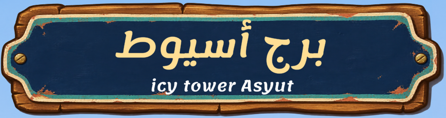
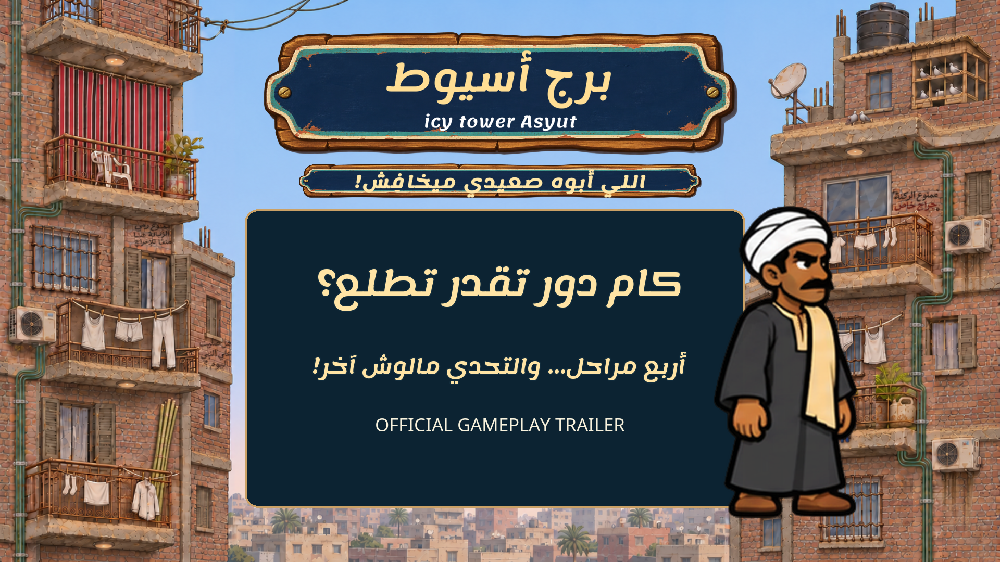

# برج أسيوط · icy tower Asyut

An Egyptian 2D arcade tower climber built with **Unity 6000.3.2f1** for Windows. Run, build momentum, leap across floors, rebound off walls and chain somersaults between Assiut-inspired apartment buildings.

**اللي أبوه صعيدي ميخافِش!**

[Download Windows build](https://github.com/mohamadhussien6/borg-asyut/releases/tag/r37-final) · [Watch or download the official trailer](https://github.com/mohamadhussien6/borg-asyut/releases/download/r37-final/Borg_Asyut_Official_Trailer.mp4) · [Documentation PDF](https://github.com/mohamadhussien6/borg-asyut/releases/download/r37-final/Borg_Asyut_Documentation.pdf)

## Official trailer

A 64-second 1920×1080 trailer at 60 FPS. Gameplay images are captured directly from the actual R37 Unity game; promotional captions and the thumbnail are composed from existing game assets. No generated gameplay or AI video is used.

## The game

A Saidi character in a charcoal galabeya, white turban, shawl and balgha climbs a continuous tower framed by Egyptian residential architecture: exposed brick, worn plaster, balconies, laundry, rooftop details and hand-painted Arabic writing. The shisha-shaped danger meter warns when the camera catches up.

The challenge is built around momentum rather than repeated identical jumps. Faster takeoff produces higher jumps; early release cuts jump height. Successful floor-skipping jumps build combos, while increasing camera pressure and narrower routes raise the difficulty. Falling below the camera ends the run, with a quick restart available.

## Controls

| Input | Action |
|---|---|
| A / D or Left / Right | Move and build momentum |
| Space | Jump; release early for a shorter jump |
| Escape | Pause or resume |
| R after Game Over | Restart |
| Alt + Enter | Toggle display mode |

## Four continuous stages

| Floors | Arabic name | Platform appearance |
|---|---|---|
| 1–20 | بلكونات الحارة | Chipped beige balcony plaster and exposed brick |
| 21–45 | فوق السطوح | Worn terrazzo, cement and rooftop waterproofing |
| 46–75 | تحت التشطيب | Red clay brickwork with a thin concrete top |
| 76+ | سر الفراعنة | Gold and blue pharaonic coffin platforms |

Stage introductions appear for three gameplay seconds. The four art skins retain the existing platform alignment, collision dimensions, generation and difficulty settings.

## Gameplay features

- Speed-based jumps, coyote time and buffered jump input.
- Controlled wall rebounds and visual somersaults.
- Seeded reachable platform routes with pooling.
- Height scoring, combo bonuses and saved best scores.
- Connected Arabic menus, pause, help and sound controls.
- Original supplied Saidi voice reactions and separate audio controls.

All 15 original 1920×1080 promotional screenshots are in [Media/Screenshots](Media/Screenshots).

## Run the project

1. Clone this repository with Git LFS installed, then run `git lfs pull`.
2. Add the project folder in Unity Hub and use **Unity 6000.3.2f1**.
3. Allow Unity to restore packages and regenerate its Library folder.
4. Open `Assets/Ma3alem/Scenes/MainMenu.unity` and press Play.

For the standalone version, extract the complete release ZIP and run `icy tower Asyut.exe`. Keep its Data directory, UnityPlayer.dll and runtime folders together.

## Source organization

`Assets/Ma3alem/Scripts` contains seven main gameplay scripts: PlayerController, PlatformSpawner, CameraFollow, ScoreManager, GameManager, AudioManager and UIManager. BuildingBackdrop is the presentation helper. Scenes, prefabs, artwork, fonts, audio and metadata remain under Assets. Packages and ProjectSettings are included. Tests remain in Assets/Ma3alem/Tests.

## Five member team

Names are intentionally blank pending completion by the team. Responsibilities below are proposed divisions for the practical.

| Member | Name | Responsibility |
|---|---|---|
| 1 |  | Player movement and physics |
| 2 |  | Platform generation and zones |
| 3 |  | Camera, scoring and game states |
| 4 |  | Art and Arabic interface |
| 5 |  | Audio, QA and documentation |

## Assets and attribution

- Game artwork includes AI-assisted production and user-provided visual references. Promotional gameplay captures themselves are genuine engine renders.
- Supplied Saidi voice recordings retain their original performance, pitch and speed. Project sound effects remain in Assets/Ma3alem/Audio.
- Lemonada and Noto fonts retain their SIL Open Font License notices under Assets/Ma3alem/Fonts and third-party resource folders.
- RTLTMPro retains its MIT license under Assets/ThirdParty. Other bundled TMP font notices remain alongside their resources.
- The selected local MP3 is excluded from repository source and the distributable Windows build. The private promotional trailer uses the owner-selected soundtrack; no replacement track was created. No public music-redistribution license is asserted.
- No open-source license is granted for the project as a whole by this handoff. Third-party license notices apply to their respective components.

## Verification and release scope

R37 native verification reached all four zones and floor 166 with real jumping, landings, both wall rebounds and combos; no logged gameplay errors occurred during the capture run. A temporary capture-only harness produced 4500 native frames at 60 simulation frames per second plus the original mixed game audio. It changes neither game artwork nor mechanics, and the original 381 source/asset/settings files were restored and hash-checked afterward.

The release Windows package compiled successfully. Earlier full Play Mode testing did not complete, and fresh score-persistence and manual acceptance checks remain pending; a fully passing test suite is not claimed. See the four-section [documentation](Documentation/Final/Asyut_Game_Documentation.md).

Large playable builds and the trailer are attached to the GitHub Release rather than committed into source. This repository remains **private**.
